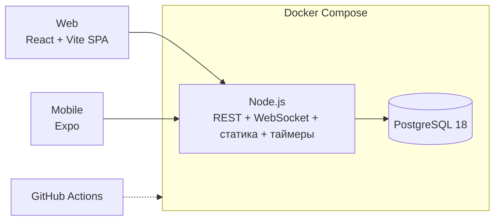

# Обзор проекта: платформа карточных игр (внутренний проект)

| | |
|---|---|
| **Статус** | Draft v2.0 — обзор |
| **Дата** | 25.11.2026 |
| **Связанные документы** | [Архитектура](./01-architecture.md) · [Стек](./02-stack.md) · [Игровые движки](./03-game-engines.md) · [План](./04-plan.md) |

Внутренний инструмент для сотрудников: **blackjack**, **дурак** (подкидной/переводной) и **Texas Hold'em** — в браузере и мобильном приложении. Без монетизации и сторов: до 5 столов, ~30 игроков одновременно, один Docker-контейнер.

Документы — упрощённая версия проектного пакета: архитектура, стек, правила игр и план на 20 недель. Этот файл — краткое резюме и точка входа.

---

## TL;DR

- **Стек:** три самостоятельных TypeScript-проекта в одном репозитории — `server`, `web`, `mobile`. `React 19 + Vite 8` (отдельный SPA) + `Mantine 9` + `Redux Toolkit` (web), `Expo SDK 58` + `React Native Paper` (mobile), `Node.js 26 LTS + NestJS 12` + `ws`, `PostgreSQL 18`. Всё.
- **Архитектура:** один Docker-контейнер (Node: REST + WebSocket + статика + таймеры) и PostgreSQL. Нет Redis, NATS, Caddy, воркеров, Kubernetes.
- **Данные:** состояние стола в памяти, в PostgreSQL — пользователи, фишки, раздачи (seed + журнал действий + итог), чат, рейтинги. Без event sourcing и двойной записи леджера.
- **Простота:** фишки списываются/начисляются только в конце раздачи, поэтому падение процесса не теряет деньги — незавершённая раздача просто аннулируется.
- **Игровое ядро:** чистые движки правил + server-authoritative + проекции (чужие карты не уходят клиенту). Правила покрыты property- и golden-тестами.
- **Порядок:** blackjack → дурак → покер cash. Каждая фаза заканчивается играбельным результатом.
- **Сроки:** 20 недель (01.12.2026 → 16.04.2027), команда 3.5–4 человека.
- **Бюджет:** ~$66–99k при аутсорсе (16.5 чел-мес), инфраструктура $0 на MVP (существующая машина), позже ~$10–15/мес.
- **Не входит:** турниры, магазин, IAP, сторы, пуши, сезоны, античит, HA.

---

## Что упрощено по сравнению с «публичным» вариантом

| Было бы для публичного продукта | Здесь |
|---|---|
| Микросервисы, отдельный realtime, воркеры | один процесс NestJS: REST + WS + таймеры |
| PostgreSQL + Redis + NATS + Kafka | только PostgreSQL |
| Kubernetes, Terraform, Helm, CDN/WAF | один Docker Compose: app + PostgreSQL |
| Двойная запись, эскроу, сверки | простой баланс + `wallet_tx`, расчёт в конце раздачи |
| Event sourcing, снапшоты, lease/fencing | состояние в памяти, журнал действий в `hands.actions` |
| Commit-reveal с публичным верификатором | seed + hash, раскрытие в истории раздачи |
| Стор-релизы, IAP, аналитика, мониторинг-стек | внутренние сборки, логи + админ-счётчики |
| shadcn/Tailwind + Zustand | Mantine 9 + Redux Toolkit (+ RTK Query) |
| Единое Next-приложение | web — отдельный React SPA на Vite |
| 845 человеко-дней, 36 недель | 264 человеко-дня, 20 недель |

---

## Документы

| Документ | Содержание |
|---|---|
| [01-architecture.md](./01-architecture.md) | Контекст и допущения, схема из трёх компонентов, backend, клиенты, схема БД, отказы, безопасность, тестирование, ёмкость, что упрощено |
| [02-stack.md](./02-stack.md) | Технологии и версии, 8 ADR (Mantine, Redux Toolkit, Vite, изоляция проектов), структура проектов, что не берём, стоимость |
| [03-game-engines.md](./03-game-engines.md) | Правила и конечные автоматы blackjack/дурака/покера, крайние случаи, инварианты, тест-план |
| [04-plan.md](./04-plan.md) | Скоуп, дорожная карта на 20 недель, команда, 264 pd, бюджет, спринты, риски, DoD, релиз |

---

## Архитектура в одной картинке

---

## Скоуп

**Входит:** аккаунты по инвайтам, кошелёк фишек, лобби с ≤5 столами (набор настраивает админ), blackjack (соло), дурак (2–6, два варианта, рейтинг), покер NLHE cash 6-max, чат, история с реплеем, админка, iOS/Android (внутренние сборки), **два языка — русский и английский**.

**Не входит:** турниры, магазин/косметика, платежи, пуши, сезоны, друзья/кланы, антиколлюзия, публичный доступ, сторы.

---

## Допущения

1. **Аудитория — сотрудники**: до 5 столов, ~30 игроков одновременно, до 50 аккаунтов; доверенная среда.
2. **MVP — один Docker-контейнер** на любой машине; где хостить — решим после MVP.
3. **Два языка — русский и английский**: переключатель в интерфейсе, выбор сохраняется в профиле; строки только в ресурсах, без хардкода.
4. **Мобильные сборки** — APK/TestFlight, без публикации в сторах.
5. **Старт 01.12.2026**; если команды ещё нет — добавить 2–4 недели на найм.
6. **Web — отдельный проект:** React 19 + Vite, свой `package.json`, сборка и деплой; при необходимости выносится в отдельный репозиторий. Общий код подключается версионируемыми пакетами, без workspace-зависимостей.
7. **Бэкапов БД нет:** сохранность истории и фишек при потере хоста не гарантируется — осознанное решение для внутреннего инструмента.

---

## Открытые вопросы

| # | Вопрос | По умолчанию |
|---|---|---|
| 1 | Сколько пользователей? | до 5 столов, ~30 игроков — **решено** |
| 2 | Мобильное приложение? | **да, нужно** |
| 3 | Турниры? | **нет** |
| 4 | Хостинг | MVP — локальный Docker; позже VM/внутренний сервер |
| 5 | Дедлайн | 16.04.2027 |
| 6 | SSO | нет, email+пароль |
| 7 | Языки | RU + EN — **решено** |

---

## Следующие шаги

1. Согласовать скоуп и правила по умолчанию (особенно дурак: подкидной/переводной).
2. Подтвердить состав команды и дату старта.
3. Запустить спринт 1 по чек-листу [плана, §12](./04-plan.md#12-первая-неделя).
4. После альфы blackjack (29.01.2027) пересмотреть оценку покера — это главный риск срока.
