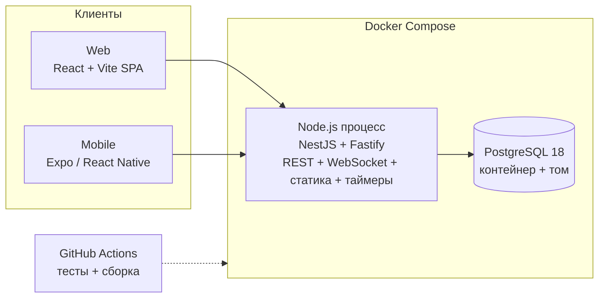

# Архитектура платформы (внутренний проект)

| | |
|---|---|
| **Статус** | Draft v2.0 — упрощённая версия |
| **Дата** | 25.11.2026 |
| **Скоуп** | Blackjack, Дурак, Texas Hold'em; web + mobile |
| **Режим** | Внутренний инструмент: до 5 столов, ~30 игроков, без монетизации и публичного доступа |
| **Связанные документы** | [Обзор](./00-overview.md) · [Стек](./02-stack.md) · [Игровые движки](./03-game-engines.md) · [План](./04-plan.md) |

---

## 1. Контекст и допущения

Проект делается для внутреннего использования: сотрудники играют в карточные игры в свободное время. Это не публичный продукт, не казино и не бизнес: нет монетизации, магазина, платежей, сторов и регуляторных требований.

Из этого следуют жёсткие упрощения:

| Параметр | Значение |
|---|---|
| Пользователи | до 50 аккаунтов, ~30 одновременно |
| Нагрузка | до 5 столов, <20 сообщений/с |
| Размещение | один Docker-контейнер + PostgreSQL; хост — на выбор |
| Доступ | внутренняя сеть, HTTP (HTTPS — после выбора хостинга) |
| Интерфейс | русский + английский, переключение в UI |
| Регистрация | по инвайт-коду, которую выдаёт админ |
| Мобильные | внутренние сборки (APK/TestFlight), без публикации в сторах |
| Платежи | отсутствуют; фишки начисляет система/админ |
| Эксплуатация | один инженер «по совместительству», без дежурств |

### 1.1 Требования (сознательно скромные)

| Требование | Цель |
|---|---|
| Задержка действия | p95 ≤ 250 мс в локальной сети/регионе |
| Доступность | «в рабочее время»; падение на 1–2 минуты считается приемлемым |
| Реконнект | ≤ 2 с, состояние стола восстанавливается |
| Сохранность данных | фишки и история не теряются при перезапуске; бэкапов БД нет — осознанно |
| Скрытые карты | не покидают сервер до вскрытия |
| Восстановление после падения | автоматический перезапуск, активные раздачи аннулируются |
| Сопровождение | понятная кодовая база, минимум инфраструктуры |
| Локализация | RU + EN, переключение без перезагрузки |

Если проект когда-нибудь станет публичным, менять придётся немного: добавить Redis/брокер, вынести realtime, включить нормальный мониторинг и античит. Это осознанно отложено (см. §12).

---

## 2. Принципы

1. **Один процесс, одна БД, один сервер.** HTTP, WebSocket, статика, таймеры и фоновые задачи живут в одном Node-процессе. Нет Redis, нет брокера сообщений, нет отдельных воркеров.
2. **Простые данные.** Состояние стола — в памяти; в PostgreSQL пишем результат раздачи, журнал действий (для реплея) и движение фишек. Без event sourcing, без двойной записи в леджере, без саг.
3. **Server-authoritative.** Клиент присылает намерение, сервер решает, легально ли оно. Никакой клиентской логики, влияющей на результат.
4. **Скрытые карты — только через проекции.** У движка нет способа отдать клиенту чужую карту: есть `view(state, viewer)`.
5. **Чистые движки правил.** `state' = reduce(state, action, rng)`; без I/O, времени и случайности внутри.
6. **Никакой инфраструктуры «на вырост».** Всё, что не нужно для 5 столов и ~30 игроков, не появляется в проекте.
7. **Простое лучше автоматизированного.** Ручной деплой по кнопке лучше, чем Kubernetes и Terraform.

---

## 3. Схема системы



### 3.1 Компоненты

| Компонент | Ответственность | Где живёт |
|---|---|---|
| `app` | REST API, WebSocket, статика web, реестр столов, движки, таймеры, авторизация, кошелёк, чат, админка | контейнер |
| `postgres` | пользователи, фишки, раздачи, история, чат, рейтинги | контейнер + том |
| CI | сборка, тесты, сборка образов | GitHub Actions |

Один контейнер — это нормально: при 5 столах и <20 сообщениях/с узкое место не наступит. Горизонтальное масштабирование не проектируем.

---

## 4. Backend

### 4.1 Структура процесса

```
apps/server/src/
├── auth/            # регистрация по инвайту, логин, JWT, ws-тикет
├── users/           # профиль, роли, настройки
├── wallet/          # баланс, транзакции, начисление
├── lobby/           # каталог столов, конфиги
├── tables/          # реестр столов, runtime, таймеры, протокол
│   ├── runtime/     # TableActor, очередь действий, seq, проекции
│   └── games/       # обёртки над движками из @cg/domain
├── chat/            # сообщения за столом
├── ratings/         # Elo для дурака и покера
├── admin/           # пользователи, столы, раздачи, начисления
└── infra/           # БД, логи, health, конфиг
```

NestJS даёт модули, guards и DI — этого достаточно, чтобы не изобретать структуру. Fastify-адаптер — для скорости и простоты.

### 4.2 HTTP API

REST/JSON, префикс `/api/v1`. Все мутации идемпотентны там, где важно (начисления, расчёт раздачи).

| Группа | Эндпоинты |
|---|---|
| Auth | `POST /auth/register` (инвайт), `/login`, `/logout`, `GET /me` |
| Realtime | `POST /realtime/ticket` — одноразовый тикет для WS |
| Lobby | `GET /lobby`, `GET /tables/:id` — фиксированные столы и свободные места |
| Wallet | `GET /wallet`, `GET /wallet/transactions` |
| History | `GET /hands`, `GET /hands/:id`, `GET /hands/:id/replay` |
| Rating | `GET /ratings`, `GET /leaderboard` |
| Profile | `PATCH /me` (в т.ч. `locale`), `GET /users/:id` |
| Admin | `GET /admin/users`, `PATCH /admin/users/:id`, `POST /admin/users/:id/chips`, `GET /admin/hands`, `GET /admin/invites`, `POST /admin/invites` |
| Health | `GET /health` (без авторизации, для проверки и деплоя) |

Ошибки — `application/problem+json` с машинным `code` (`ERR_INSUFFICIENT_FUNDS`, `ERR_TABLE_FULL`, …).

### 4.3 Realtime-протокол

WebSocket, JSON. В локальной сети — `ws://`, после выбора хостинга — `wss://`. Тикет: `POST /api/v1/realtime/ticket` → `{ticket}` (TTL 60 с, одноразовый), подключение `ws(s)://<host>/ws?ticket=...`.

Конверт:

```json
{ "v": 1, "type": "action", "payload": { } }
```

| Направление | Тип | Назначение |
|---|---|---|
| C→S | `join` | сесть за стол |
| C→S | `action` | игровое действие |
| C→S | `leave` | выйти |
| C→S | `chat` | сообщение в чат |
| C→S | `resume` | восстановление после обрыва |
| S→C | `hello` | `serverTime`, параметры сессии |
| S→C | `joined` | snapshot (`view`, `seq`) + конфиг |
| S→C | `event` | дельта состояния |
| S→C | `ack` | подтверждение действия + новый `seq` |
| S→C | `error` | код ошибки |
| S→C | `resume_failed` | снапшот недоступен — нужен новый `join` |

Действие:

```json
{
  "type": "action",
  "payload": {
    "tableId": "t_1",
    "handId": "h_42",
    "seq": 128,
    "clientActionId": "d4b2-…",
    "move": { "type": "raise", "to": 120 }
  }
}
```

Сервер проверяет: сессия/тикет → посадка за стол → `handId`/`seq` актуальны → `move` входит в `legal` → применяет. Повтор с тем же `clientActionId` возвращает тот же `ack` (окно 5 минут), поэтому реконнект не «прокручивает» действие дважды.

**Проекции.** Каждому получателю отправляется `view(state, viewer)`: свои карты видны, чужие — `null` до вскрытия. Наблюдателей нет. Это единственный путь наружу; сырое состояние стола никогда не сериализуется в сокет.

**Таймеры.** Дедлайны считаются на сервере, в событиях передаётся `deadlineAt` (UTC). Клиент рисует прогресс, но решение о таймауте принимает сервер: по истечении — авто-действие (fold/check, взял/пас, stand).

**Реконнект.** Клиент хранит `{tableId, seq, resumeToken}` и после обрыва шлёт `resume`. Сервер доигрывает события из памяти; если не может — `resume_failed`, клиент делает `join` и получает снапшот. Буфер событий на столе — последние 500.

### 4.4 Runtime столов

- `Map<tableId, TableActor>` в памяти процесса.
- Актор обрабатывает действия последовательно: это и есть «один писатель на стол», без блокировок.
- На каждое действие: валидация → `apply` → инварианты → `seq++` → рассылка проекций → сохранение в БД.
- В БД на каждое действие — `UPDATE hands SET actions = actions || $1` (журнал для реплея) и, в конце раздачи, `result` + проводки по кошельку. Один-два UPDATE на действие при нашем объёме — не проблема.
- Таймеры — `setTimeout`/timer wheel в процессе; после рестарта незавершённые раздачи не восстанавливаются, а аннулируются (см. §8).
- Столы поднимаются при старте из конфига (не больше 5) или админом; игрок занимает свободное место.

### 4.5 Кошелёк (простая модель)

Никакого эскроу и двойной записи:

- У пользователя один баланс (`wallets.balance`).
- Во время раздачи фишки «резервируются» только в памяти стола; баланс в БД не меняется.
- В конце раздачи считаем `net` по каждому игроку и одной транзакцией пишем `wallet_tx` + обновляем баланс. Ключ идемпотентности — `hand:{handId}:{userId}`.
- Если процесс упал в середине раздачи — раздача аннулируется, в БД ничего не проводилось, фишки не потеряны. Это главное преимущество простой модели.
- Дурак — без фишек (только рейтинг), поэтому денежная логика нужна только для blackjack и покера.
- Один активный стол на пользователя: садишься за новый — старый закрывается.

Ограничения: нельзя играть за двумя столами одновременно; «подарить» фишки нельзя (только админ начисляет). Для внутреннего проекта этого достаточно.

### 4.6 Авторизация

- Email + пароль, Argon2id. Регистрация только по инвайт-коду (админ создаёт пачкой).
- JWT (ES256) в `httpOnly` cookie, срок 7 дней; для WS — одноразовый тикет из REST.
- Роли: `player`, `admin`. Админ-эндпоинты защищены guard'ом и дополнительно проверкой allowlist-IP (опционально).
- Сброс пароля — админом (внутренний инструмент, не нужен self-service).

### 4.7 Админка

Раздел `/admin` в том же web-приложении:

| Экран | Действия |
|---|---|
| Пользователи | поиск, блокировка, выдача фишек, смена роли |
| Инвайты | создание/отзыв кодов |
| Столы | список активных, закрыть, изменить лимиты |
| Раздачи | поиск по игроку/столу, просмотр и реплей, seed и actions |
| Конфиги | лимиты ставок, таймеры, варианты правил |

Ручные начисления — с записью в `audit_log` (кто, кому, сколько, зачем).

---

## 5. Клиенты

Web и mobile — отдельные приложения со своими `package.json` и сборками; общими остаются пакеты `protocol`, `domain`, `client-core`, `i18n`. Web можно вынести в отдельный репозиторий без изменений кода.

### 5.1 Общий слой

Web и mobile используют один пакет `@cg/protocol` (типы сообщений, Zod-схемы, коды ошибок) и один пакет `@cg/client-core`:

- WS-клиент с конечным автоматом `connecting → joined → live → resuming`;
- Redux Toolkit: slices `session`, `lobby`, `table`, `chat`, `ui`; RTK Query для REST;
- i18n: ресурсы RU/EN в `@cg/i18n`, переключение языка в шапке/профиле, форматирование дат и чисел через `Intl`;
- обработка `seq`: события применяются строго по порядку, при гэпе — `resume`;
- очередь действий с `clientActionId` и повтор после реконнекта;
- **никакого оптимистичного изменения состояния стола** — сначала `ack`/событие, потом рендер (анимация нажатия — локальная).

### 5.2 Web

- Отдельное приложение `apps/web`: React 19 + Vite + React Router. Сборка — статика, раздаёт тот же Node-процесс; SSR/SEO не нужны, деплой проще.
- Mantine 9: компоненты, `@mantine/hooks`, `@mantine/notifications`, формы, модалки; свой CSS — минимум, через `styles`/CSS modules.
- Redux Toolkit + RTK Query: `tableSlice` — единственный источник состояния стола; DevTools бесплатно помогают отлаживать.
- Экран стола: карты — DOM + CSS-трансформации (без canvas на старте), анимации — CSS/Mantine Transition.
- Клавиатура: `H` — hit, `S` — stand, `D` — double, `Space` — подтверждение; фокус-ловушки в модалках.
- Роуты: `/lobby`, `/table/:id`, `/history`, `/profile`, `/admin`.

### 5.3 Mobile

- Expo SDK 58, React Native 0.88, Expo Router.
- React Native Paper (Material) — потому что Mantine не поддерживает React Native; протокол и Redux-слои общие с web.
- Экран стола: те же компоненты карт в RN-исполнении; анимации — Animated/Reanimated при необходимости, без Skia на старте.
- Сборка: EAS Build локально/в CI, внутренняя раздача — APK для Android, TestFlight для iOS. Без сторов, без IAP, без пушей.

### 5.4 Путь действия

```
UI → dispatch(moveQueued) → WS send → ... → ack/event → tableSlice → renders
```

Клиент ничего не считает: суммы `call`/`minRaiseTo` приходят в `legal`, состояние — в `view`.

---

## 6. Данные

### 6.1 Схема PostgreSQL

```sql
create extension if not exists pgcrypto;
create extension if not exists citext;

create table users (
  id            uuid primary key default gen_random_uuid(),
  email         citext unique not null,
  password_hash text not null,                 -- argon2id
  nickname      citext not null unique,
  role          text not null default 'player' check (role in ('player','admin')),
  is_blocked    boolean not null default false,
  locale        text not null default 'ru' check (locale in ('ru','en')),
  created_at    timestamptz not null default now()
);

create table invites (
  code       text primary key,
  created_by uuid references users(id),
  used_by    uuid references users(id),
  created_at timestamptz not null default now(),
  used_at    timestamptz
);

create table wallets (
  user_id    uuid primary key references users(id) on delete cascade,
  balance    bigint not null default 1000 check (balance >= 0),
  updated_at timestamptz not null default now()
);

create table wallet_tx (
  id              bigserial primary key,
  user_id         uuid not null references users(id),
  delta           bigint not null check (delta <> 0),
  reason          text not null,               -- hand | admin | start
  hand_id         uuid,
  idempotency_key text not null unique,
  created_at      timestamptz not null default now()
);
create index wallet_tx_user_idx on wallet_tx (user_id, id desc);

create table tables (
  id         uuid primary key,
  game       text not null check (game in ('blackjack','durak','holdem')),
  config     jsonb not null,
  status     text not null default 'open' check (status in ('open','closed')),
  created_by uuid references users(id),
  created_at timestamptz not null default now()
);

create table hands (
  id            uuid primary key,
  table_id      uuid not null references tables(id),
  hand_no       int not null,
  game          text not null,
  rules_version int not null,
  seed_hash     bytea not null,
  seed          bytea,                         -- раскрывается после раздачи
  actions       jsonb not null default '[]',    -- журнал для реплея
  result        jsonb,                          -- итоги: net по игрокам
  status        text not null default 'running'
                check (status in ('running','completed','voided')),
  started_at    timestamptz not null default now(),
  ended_at      timestamptz,
  unique (table_id, hand_no)
);
create index hands_table_idx on hands (table_id, hand_no desc);

create table chat_messages (
  id         bigserial primary key,
  table_id   uuid references tables(id) on delete cascade,
  user_id    uuid not null references users(id),
  body       text not null,
  created_at timestamptz not null default now()
);
create index chat_table_idx on chat_messages (table_id, id desc);

create table ratings (
  user_id    uuid not null references users(id) on delete cascade,
  game       text not null check (game in ('durak','holdem')),
  rating     int not null default 1200,
  games      int not null default 0,
  updated_at timestamptz not null default now(),
  primary key (user_id, game)
);

create table audit_log (
  id         bigserial primary key,
  actor_id   uuid references users(id),
  action     text not null,
  details    jsonb,
  created_at timestamptz not null default now()
);
```

Всё остальное — в памяти (состояние стола) или в конфигах (правила, лимиты). Девять таблиц вместо трёх десятков.

### 6.2 Ретеншн данных

| Данные | Срок |
|---|---|
| `hands` (с `actions`) | 1 год, потом удаление |
| `wallet_tx` | бессрочно |
| `chat_messages` | 90 дней (cron-удаление) |
| `audit_log` | 1 год |

**Бэкапы БД не делаем.** Это осознанное решение для внутреннего инструмента: при потере хоста история раздач и фишки теряются, но ничего критичного для компании не происходит. Если данные станут ценными — `pg_dump` в cron включается за 10 минут, без изменений в коде.

---

## 7. Игровые движки (кратко)

Подробности — в [документе движков](./03-game-engines.md). Здесь только архитектурные договорённости:

```ts
interface GameDefinition<S, A, E, V> {
  readonly id: 'blackjack' | 'durak' | 'holdem';
  init(ctx): S;
  startHand(state, ctx, rng): StepResult<S, E>;
  legalActions(state, seat): ActionDescriptor[];
  apply(state, action, ctx, rng): StepResult<S, E>;
  view(state, viewer): V;          // проекция, без чужих карт
  isHandOver(state): boolean;
  settle(state): Settlement;       // net по игрокам
  timers(state): TimerSpec[];
  invariants(state): void;         // проверки в dev
}
```

- Движки — в `packages/domain`, без I/O, времени и `Math.random`.
- Случайность: на раздачу генерируется `seed` (32 байта CSPRNG), `seed_hash` пишется до раздачи, колода тасуется потоком `HMAC-SHA256(seed, handId)`; после раздачи `seed` раскрывается и сохраняется в `hands`. Админ может воспроизвести раздачу; публичный верификатор для внутреннего проекта не нужен.
- Таймеры: движок возвращает дедлайны, runtime их взводит; авто-действие — обычное действие с флагом `auto`.
- Боты: используются, чтобы заполнить дурака и протестировать столы; помечены в UI, в рейтинг не идут.

---

## 8. Отказы и эксплуатация

### 8.1 Падение процесса

1. Docker перезапускает контейнер (`restart: unless-stopped`), простой — секунды.
2. Столы в памяти теряются. Незавершённые раздачи помечаются `voided` (по `started_at`).
3. Денег это не касается: баланс меняется только при завершении раздачи, поэтому аннулирование безопасно.
4. Игроки после реконнекта видят лобби и садятся заново; в истории остаётся запись `HAND_VOIDED`.

### 8.2 Деплой

- MVP: `docker compose up -d --build` на машине, где будет крутиться игра (ноутбук, мини-ПК, внутренний сервер).
- GitHub Actions: тесты и сборка; деплой — вручную или по SSH, когда появится постоянный хост.
- Простой — 10–30 секунд.
- Миграции: `drizzle-kit generate` + применение при старте контейнера; деструктивные миграции не делаем.
- Откат — предыдущий коммит и повторная сборка.

### 8.3 Наблюдаемость

Минимум, без Grafana-стека:

- структурированные логи (`pino`) → `docker logs`, ротация;
- `GET /api/v1/health` для проверки после деплоя;
- админ-страница со счётчиками: пользователи онлайн, активные столы, ошибки за сутки;
- опционально Sentry (free tier) для ошибок web/server — включается за 15 минут, если понадобится.

---

## 9. Безопасность (для внутреннего проекта)

| Риск | Мера |
|---|---|
| Доступ посторонних | регистрация по инвайтам, только внутренняя сеть; HTTPS — после выбора хостинга |
| Кража сессии | JWT в httpOnly cookie, короткий тикет для WS, SameSite |
| Подмена действий | server-authoritative, `legal` на сервере, `seq`/идемпотентность |
| Утечка карт | проекции + тест «нет чужих карт» на 10 000 раздач |
| Флуд | in-memory rate limit (20 сообщений/с на соединение, 1 чат/2 с) |
| Слабые пароли | Argon2id, минимальная длина 10, бан после 5 неудач |
| Данные | доступ к БД только с сервера, секреты в `.env` с правами 600 |

Чего сознательно нет: WAF, антифрод, KYC, антиколлюзия, ML-детекторы, сертификация RNG. Угроза «сговор сотрудников» решается социально, а не кодом.

---

## 10. Тестирование

| Уровень | Инструмент | Что проверяем |
|---|---|---|
| Unit | Vitest | карты, оценка руки, выплаты, сайд-поты, валидация |
| Golden replay | Vitest snapshot | 20–50 эталонных раздач на игру (фиксированный seed) |
| Property | fast-check | инварианты: колода без дублей, фишки сохраняются, раздача завершается, в проекции нет чужих карт |
| Интеграционные | Vitest + Testcontainers (PG) | стол + runtime + БД, реконнект, расчёт |
| E2E | Playwright | вход, посадка, игра раунда, реконнект, админка |
| Приёмка | чек-лист | перед внутренним релизом, вручную на web и mobile |

Нагрузочные тесты не делаем: 5 столов и ~30 игроков — не тот масштаб. Достаточно прогона в день релиза и просмотра логов.

---

## 11. Ёмкость

| Показатель | Оценка на пике |
|---|---|
| Пользователей онлайн | ~30 |
| Столов | до 5 (например, 2 × blackjack, 2 × дурак, 1 × покер) |
| Сообщений/с | < 20 |
| Записей в БД/с | ~5 |
| RAM процесса | 128–256 МБ |
| RAM PostgreSQL | 512 МБ–1 ГБ |
| CPU | < 0.5 ядра |
| Диск | 10 ГБ (БД + образы) |

Хватает любого Docker-хоста: 1–2 vCPU, 2 ГБ RAM, 10 ГБ диска. В MVP — Docker Compose на существующей машине; позже переносится на VM без изменений.

---

## 12. Что упрощено и когда усложнять

| Упрощение | Почему допустимо | Когда усложнять |
|---|---|---|
| Один процесс, один контейнер | ~30 игроков и 5 столов, падение терпимо | если проект станет публичным или игроков станет 200+ |
| Фиксированные 5 столов вместо матчмейкинга | малая аудитория, игроки сами занимают места | если понадобится очередь и подбор по рейтингу |
| Нет бэкапов БД | внутренний инструмент, потеря истории допустима | если данные станут ценными |
| Нет Redis | всё состояние в памяти, сессии в JWT | несколько инстансов, нужен общий presence/кэш |
| Нет NATS/воркеров | нет фоновых задач, кроме таймеров и cron | турниры, рассылки, тяжёлая аналитика |
| Нет двойной записи леджера | фишки виртуальные, аудит — `wallet_tx` + `audit_log` | реальные деньги или сложная экономика |
| Нет event sourcing | журнал `actions` + `result` в `hands` достаточно для реплея | споры и античит на большом объёме |
| Аннулирование раздач при падении | деньги не двигаются до конца раздачи | если появятся ставки «в процессе» |
| Нет мобильных сторов, пушей, IAP | внутренние сборки | публичный релиз |
| Только два языка (RU/EN), без сложной плюрализации | внутренней аудитории хватает | если появятся носители других языков |
| Нет Grafana/PostHog | логи + админ-счётчики | когда понадобятся продуктовые метрики |
| Нет античита | доверенная внутренняя аудитория | публичный доступ |

---

## 13. Открытые вопросы

| # | Вопрос | Ответ | Влияние |
|---|---|---|---|
| 1 | Аудитория и число столов | до 5 столов, ~30 игроков — **решено** | архитектура без масштабирования |
| 2 | Мобильное приложение | **нужно** | входит в план, ~30 pd |
| 3 | Турниры | **нет** | не входит в план |
| 4 | Хостинг | MVP — Docker-контейнер; позже решим | HTTPS/домен позже |
| 5 | SSO | нет, email+пароль | 0 дней |
| 6 | Боты в дураке | только для тестов | +0 дней |
| 7 | Языки | RU + EN — **решено** | +6 pd |
