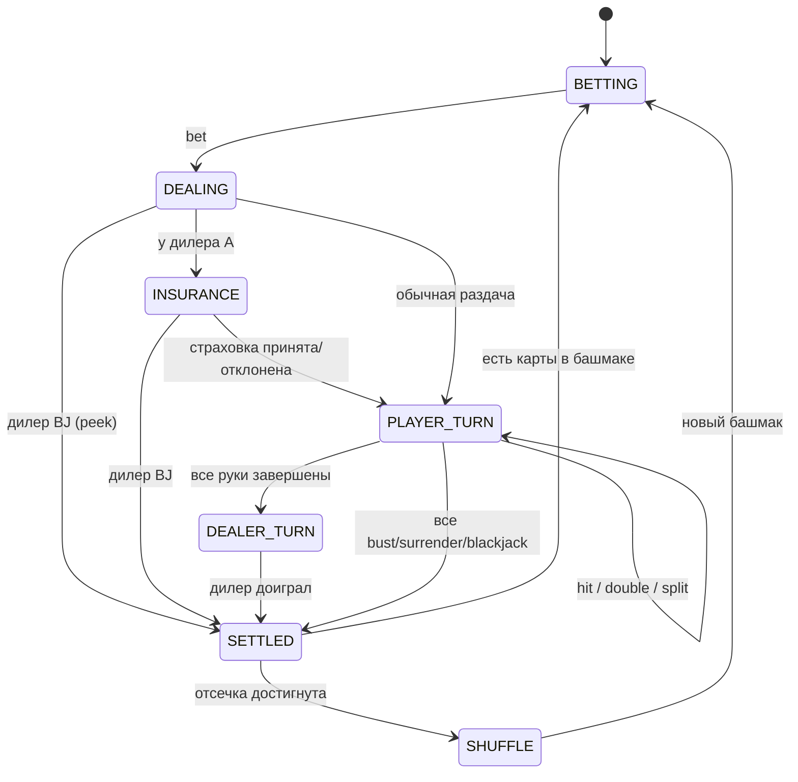
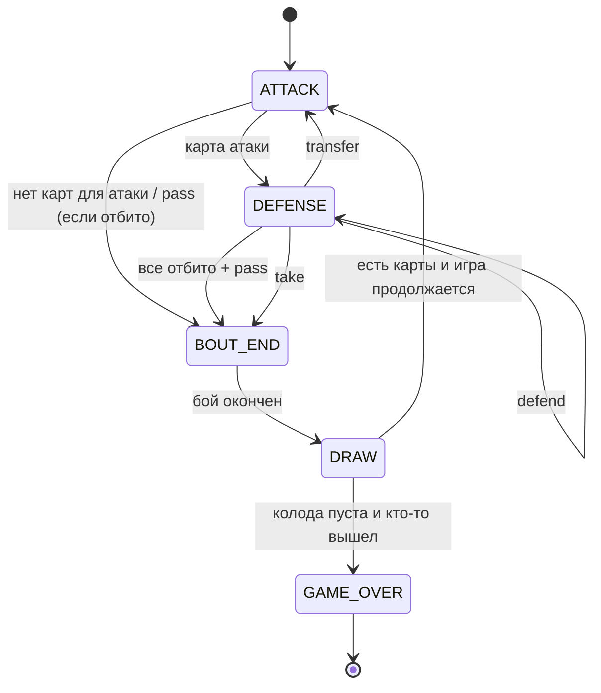
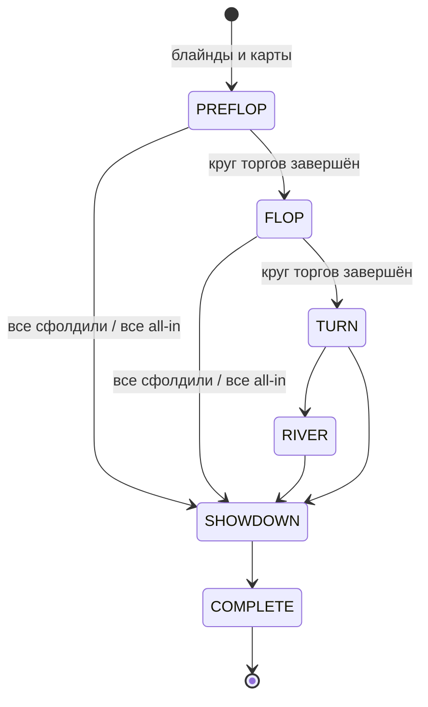

# Игровые движки и правила

| | |
|---|---|
| **Статус** | Draft v2.0 — упрощённая версия (внутренний проект) |
| **Дата** | 25.11.2026 |
| **Скоуп** | Blackjack, Дурак (подкидной/переводной), Texas Hold'em (NLHE) |
| **Связанные документы** | [Обзор](./00-overview.md) · [Архитектура](./01-architecture.md) · [Стек](./02-stack.md) · [План](./04-plan.md) |

Документ фиксирует: модели данных движков, конечные автоматы, легальные действия, крайние случаи, расчёт выплат, тестовые инварианты. Это контракт между game-логикой, сервером, клиентами, ботами и QA. Всё, что описано здесь, должно иметь тест с трассировкой «правило → тест».

---

## 0. Общие положения

### 0.1 Карты и кодирование

| Игра | Колода | Кодирование |
|---|---|---|
| Blackjack | 4 / 6 / 8 × 52 (без джокеров) | JSON: `"As"`, `"Td"`, `"2c"`; ранги `2..9,T,J,Q,K,A` |
| Дурак | 36 (6..A) или 52 | то же |
| Hold'em | 52 | то же |

```ts
type Rank = '2'|'3'|'4'|'5'|'6'|'7'|'8'|'9'|'T'|'J'|'Q'|'K'|'A';
type Suit = 's'|'h'|'d'|'c';
type Card = string;                    // `${Rank}${Suit}`, например 'As'
// Ценности: A = 11/1 (blackjack), A = 14 (покер, стрит-лоу допускается).
```

Правила:
- Сравнение карт — только через функции движка, не через строки.
- Дубли карт в любой момент — ошибка (проверяется инвариантом).
- Клиенту уходят только коды карт, без названий и мастей словами (i18n — на клиенте).

### 0.2 Случайность

Все движки получают `RandomStream`:

```ts
interface RandomStream {
  nextUint32(): number;
  nextBelow(n: number): number;    // равномерно, без modulo bias
  shuffle<T>(items: T[]): T[];     // Fisher–Yates
}
```

Продакшн-реализация — HMAC-SHA256-поток от `server_seed` (см. §8.3 архитектуры), тестовая — детерминированный PRNG. Движок не знает, откуда берётся поток.

### 0.3 Время и таймеры

- В движок передаётся `now` (UTC мс) и `deadline`.
- Движок не хранит таймеры сам: он возвращает `timers(state)` — список `{seat, kind, deadlineAt, onExpire}`.
- Runtime применяет авто-действие как обычное действие с `auto: true`.
- Просроченный таймер после рестарта: если `deadlineAt` в прошлом — сработает немедленно; если раздача уже ушла вперёд — таймер игнорируется (idempotency по `(handId, seat, actionIndex)`).

### 0.4 Фазы и действия: единая таблица

Каждая фаза возвращает ровно один набор легальных действий; UI рисует только их. Любое другое действие — `ERR_INVALID_ACTION` и запись в audit.

| Игра | Фаза | Кто действует | Действия |
|---|---|---|---|
| BJ | `BETTING` | игрок | `bet`, `rebuy`, `leave` |
| BJ | `PLAYER_TURN` | игрок (текущая рука) | `hit`, `stand`, `double`, `split`, `surrender`, `take_insurance`, `decline_insurance`, `even_money` |
| BJ | `DEALER_TURN` | сервер | — (авто) |
| Дурак | `ATTACK` | атакующий (и, по конфигу, все) | `attack`, `pass`, `transfer` (если защитник) |
| Дурак | `DEFENSE` | защитник | `defend`, `take`, `transfer` |
| Hold'em | `PREFLOP/FLOP/TURN/RIVER` | очередь `toActSeat` | `fold`, `check`, `call`, `bet`, `raise`, `all_in` |
| Hold'em | `SHOWDOWN` | сервер | — (авто) |

### 0.5 Результат шага

```ts
type StepResult<S, E> = {
  ok: true;
  state: S;
  events: E[];
} | {
  ok: false;
  error: { code: ErrorCode; message: string; details?: unknown };
};
```

`settle(state)` вызывается только когда `isHandOver(state) = true` и возвращает:

```ts
interface Settlement {
  outcomes: Array<{ seat: number; userId: string; delta: number; reason: 'win'|'loss'|'push'|'forfeit'|'void' }>;
  totalPot: number;
  resultHash: string;      // хэш итога для аудита
}
```

---

## 1. Blackjack

### 1.1 Модель сессии: почему соло

Классический стол на 7 мест с общим башмаком добавляет ожидание чужих ходов и синхронизацию. Для внутреннего проекта этого не нужно: **соло-стол**, где игрок владеет башмаком и играет раунды подряд. Это убирает ожидание, делает движок детерминированным для одного игрока и упрощает реконнект и расчёт. Социальная часть — лобби и чат за столом.

В лобби до 5 столов; blackjack-стол занимает один игрок за раз. Общий стол не планируется: если понадобится, это отдельная доработка поверх той же модели.

### 1.2 Конфигурация

```ts
interface BlackjackConfig {
  decks: 4 | 6 | 8;                       // default 6
  penetration: number;                     // 0..1, default 0.75
  dealerHitsSoft17: boolean;               // default false (S17)
  doubleAfterSplit: boolean;               // default true
  maxSplitHands: number;                   // default 4 (3 сплита)
  splitByValue: boolean;                   // default false (только одинаковый ранг)
  lateSurrender: boolean;                  // default false
  blackjackPays: 3 | 2;                    // default 3:2
  insurance: boolean;                      // default true
  minBet: number; maxBet: number;
}
```

Сплит тузов — по одной карте, респлит тузов запрещён: это фиксированные правила, а не конфиг. Сайд-бетов, «5-карточного Чарли» и общих башмаков нет.

### 1.3 Состояние

```ts
interface BlackjackState {
  tableId: string;
  config: BlackjackConfig;
  shoe: {
    shoeId: string;
    shoeNumber: number;
    cards: Card[];              // оставшиеся карты (верх — в конце массива)
    cutIndex: number;           // сколько карт должно остаться при отсечке
    dealt: number;
    seedHash: string;           // публикуется до первой раздачи
    seedRevealed?: string;      // после завершения башмака
  };
  player: { userId: string; balanceAtTable: number };  // стек за столом
  round: {
    roundId: string;
    phase: 'BETTING'|'PLAYER_TURN'|'DEALER_TURN'|'SETTLED'|'SHUFFLE';
    bet: number;
    insuranceBet: number;
    insuranceOffered: boolean;
    hands: Array<{
      cards: Card[];
      bet: number;
      status: 'active'|'stood'|'bust'|'blackjack'|'surrendered'|'done';
      fromSplit: boolean;
      doubled: boolean;
      acted: boolean;
    }>;
    activeHand: number;
    dealer: { up: Card; hole: Card; holeRevealed: boolean };
    outcome?: { payout: number; net: number; reason: string };
  };
  handNo: number;
}
```

### 1.4 Конечный автомат



### 1.5 Раздача и peek

1. Дилер перемешивает колоду `decks × 52`, ставит отсечку на `penetration`. `seedHash` публикуется **до** первой раздачи башмака.
2. Игрок ставит `bet` (`minBet ≤ bet ≤ maxBet`); сервер проверяет баланс. Фишки двигаются только при расчёте раздачи.
3. Раздача: игрок ← 2 карты, дилер ← up + hole.
4. Если up = A и `insurance` → предложение страховки (до любых действий игрока). Ставка ≤ `bet/2`.
5. Peek: если у дилера BJ (A + 10-value) — вскрытие, расчёт:
   - игрок BJ → push;
   - страховка → выплата 2:1;
   - иначе проигрыш ставки.
6. Если у игрока BJ (и у дилера нет BJ) — немедленная выплата 3:2, раздача завершается (настройка «BJ beats 21» не нужна: BJ всегда выигрывает до дилерских ходов).

### 1.6 Действия игрока

| Действие | Условия | Эффект |
|---|---|---|
| `hit` | рука активна, сумма < 21 | +1 карта; >21 → bust; 21 → авто-stand |
| `stand` | рука активна | рука `stood`, переход к следующей |
| `double` | ровно 2 карты, хватает денег, (после сплита — `doubleAfterSplit`) | ставка ×2, ровно 1 карта, авто-stand |
| `split` | ровно 2 карты одинакового ранга (или значения при `splitByValue`), хватает денег, `hands < maxSplitHands` | 2 руки, ставка = исходной; тузы → по 1 карте (фиксированное правило) |
| `surrender` | `lateSurrender`, ровно 2 карты, до любых действий | возврат половины ставки, рука `surrendered` |
| `take_insurance` | up = A, страховка не взята | ставка `bet/2` в страховку |
| `decline_insurance` | up = A | отказ |
| `even_money` | у игрока BJ, up = A | выплата 1:1 вместо 3:2 (эквивалент страховки) |

Правила перехода: после `stand`/`bust`/`double`/`surrender`/`blackjack` — следующая активная рука; если нет — `DEALER_TURN`. Сплит-тузы: обе руки получают по одной карте и сразу `stood`.

### 1.7 Ход дилера и выплаты

- Если все руки `bust`/`surrender` — дилер не добирает (только вскрывает hole, чтобы показать BJ, если он был).
- Дилер добирает до 17: S17 (стоит на soft 17) или H17 (берёт), согласно конфигу.
- Расчёт по каждой руке:

| Исход | Выплата |
|---|---|
| Игрок BJ, дилер не BJ | 3:2 (ставка × 2.5 возврат) |
| Игрок 21 (не BJ), дилер 21 | push |
| Игрок > дилера, дилер не bust | 1:1 |
| Дилер bust | 1:1 |
| Игрок < дилера | проигрыш |
| Surrender | 0.5 (возврат половины) |
| Страховка при BJ дилера | 2:1 |

Все суммы — целые. `net` = выплата − ставка (для статистики). `payout` округляется вниз, остаток — в пользу игрока (не создаёт дробных фишек).

### 1.8 RTP и экономика

Ориентиры (6 колод, S17, DAS, BJ 3:2, без сдачи), при игре по базовой стратегии:

| Конфигурация | Преимущество казино |
|---|---|
| 6 колод, S17, DAS, 3:2 | ≈ 0.40% |
| 8 колод, S17, DAS, 3:2 | ≈ 0.43% |
| H17 (добирает на soft 17) | +≈ 0.20% |
| Выплата BJ 6:5 | +≈ 1.40% |
| Без DAS | +≈ 0.14% |
| Late surrender | −≈ 0.08% |

Значения ориентировочные, финальные — по симуляции Монте-Карло (10–50 млн раздач) на конкретном конфиге; скрипт симуляции — часть репозитория. Для виртуальной экономики house edge не критичен, но важен баланс источников/стоков фишек: слишком щедрый BJ → инфляция, слишком жадный → отток игроков.

### 1.9 Крайние случаи (обязательные тесты)

1. Сплит 10-х (если `splitByValue=false` — запрещён; если true — 2 руки по 10).
2. Сплит тузов: одна карта каждой руке, респлит запрещён.
3. Double после сплита (DAS) и запрет double на 3+ картах.
4. BJ после сплита — это 21, а не BJ (не платим 3:2).
5. Игрок BJ + дилер A: `even_money` и страховка не должны выплачивать дважды.
6. Дилер BJ при up = 10 (без предложения страховки) — peek, немедленный расчёт.
7. Отсечка: раздача, начатая до отсечки, доигрывается; новый башмак — после завершения.
8. Закончились фишки на double/split → действие недоступно (`legalActions`), не ошибка.
9. Реконнект в середине раздачи — состояние восстанавливается.
10. `bet` больше баланса → `ERR_INSUFFICIENT_FUNDS`; смена конфига — только между раздачами.

### 1.10 Проекция для клиента

```json
{
  "tableId": "t_1",
  "phase": "PLAYER_TURN",
  "shoe": { "number": 42, "dealt": 117, "seedHash": "9f2c…" },
  "round": {
    "bet": 10, "insuranceBet": 0,
    "dealer": { "up": "Kd", "hole": null, "holeRevealed": false },
    "hands": [
      { "cards": ["As","7h"], "value": 18, "soft": true, "bet": 10, "status": "active", "fromSplit": false }
    ],
    "activeHand": 0,
    "legal": { "actions": ["hit","stand","double"], "doubleRequiresChips": 10, "splitAllowed": false },
    "deadlineAt": null
  },
  "balance": 240
}
```

`hole` = `null` до вскрытия — даже если сервер уже знает карту. Это ключевой контракт.

---

## 2. Дурак

### 2.1 Варианты и конфигурация

```ts
interface DurakConfig {
  deck: 36 | 52;                       // default 36
  players: 2 | 3 | 4 | 5 | 6;          // default 2..4
  variant: 'podkidnoy' | 'perevodnoy'; // default 'podkidnoy'
  maxAttackCards: number;              // default 6
  firstAttackLimit: number;            // default 5 (для 2 игроков — не применяется)
  throwInFromAll: boolean;             // default false (подкидывает только атакующий)
  drawOrder: 'attacker_first' | 'clockwise';
  actionClockSec: number;              // default 30
  allowPass: boolean;                  // default true («бито»)
}
```

### 2.2 Состояние

```ts
interface DurakState {
  tableId: string;
  config: DurakConfig;
  deck: Card[];                 // верх колоды — конец массива
  trump: { card: Card; suit: Suit };  // нижняя карта колоды + козырь
  discard: Card[];
  hands: Record<Seat, Card[]>;  // приватно
  table: Array<{ attack: Card; defense: Card | null; attackSeat: Seat }>;
  attackerSeat: Seat;
  defenderSeat: Seat;
  turnSeat: Seat | null;
  phase: 'ATTACK'|'DEFENSE'|'BOUT_END'|'DRAW'|'GAME_OVER';
  beaten: boolean;              // все карты на столе отбиты
  cardsDrawnThisBout: boolean;
  out: Seat[];                  // игроки без карт
  winnerSeat?: Seat;
  loserSeat?: Seat;
  result?: 'win'|'draw'|'loss';
}
```

### 2.3 Начало и раунд

1. Колода тасуется, каждому по 6 карт, нижняя карта открывается как козырь (она остаётся в колоде и берётся последней).
2. Первый атакующий — игрок с младшим козырем (при равенстве — по часовой стрелке от сдающего); если козырей ни у кого нет — случайный/первый.
3. Защитник — следующий по часовой стрелке.
4. Атака: `firstAttackLimit` карт (5) в первом бою, далее до `maxAttackCards` (6), но не больше, чем карт у защитника.
5. Защитник отбивает карты по одной. Отбить можно старшей картой той же масти или козырем (козырь бьёт некозырную карту; козырь бьётся только старшим козырем).
6. Атакующий может подкидывать карты тех же достоинств, что уже на столе (и не больше лимита).
7. Если все отбиты — атакующий говорит «бито», карты уходят в сброс, бой заканчивается.
8. Если защитник не может/не хочет — «беру»: забирает все карты со стола (и подкинутые), бой заканчивается, он пропускает следующий ход (атакующим становится следующий игрок).
9. Добор после боя: сначала атакующий, затем остальные по часовой, защитник последним — до 6 карт. Если колода пуста — не добираем.
10. Игра заканчивается, когда колода пуста и у игроков не осталось карт: последний с картами — «дурак». Если одновременно вышли все — ничья (draw).

### 2.4 Перевод (переводной)

- Разрешён только в `DEFENSE`, если **ни одна** карта не отбита.
- Защитник добавляет карту того же достоинства, что и атакующая карта (все карты на столе должны быть одного достоинства для перевода — упрощение; классическое правило: добавляет карту того же достоинства, что и атака).
- После перевода: прежний защитник становится атакующим, новый защитник — следующий по часовой; стол сохраняется, лимит атаки увеличивается на 1 (но не больше `maxAttackCards`).
- Перевести можно, только если у нового защитника есть карты.

### 2.5 Конечный автомат



### 2.6 Легальные действия

| Действие | Кто | Условия |
|---|---|---|
| `attack(card)` | атакующий (и все при `throwInFromAll`) | фаза `ATTACK`, карта в руке, стол не пуст → достоинство совпадает с любой картой стола; стол пуст → любая; лимит не превышен |
| `defend(card)` | защитник | фаза `DEFENSE`, карта бьёт последнюю неотбитую атаку |
| `take` | защитник | фаза `DEFENSE` (или `ATTACK`, если атака не отбита и защитник решил сдаться) |
| `transfer(card)` | защитник | вариант `perevodnoy`, фаза `DEFENSE`, ничего не отбито, карта того же достоинства |
| `pass` | атакующий | всё отбито, `allowPass` |
| `timeout` | сервер | защитник → `take`, атакующий → `pass` (если отбито) / ничего (если не отбито и нечего подкидывать — бой завершается взятием) |

### 2.7 Крайние случаи

1. Защитник берёт — карты со стола уходят ему в руку; атакующий не может подкидывать после «беру» (упрощение внутренней версии; в классике подкидывают до взятия — осознанно упрощаем).
2. Лимит атаки = `min(maxAttackCards, карт у защитника)`.
3. Добор не может превысить 6 карт в руке.
4. Козырь — нижняя карта, она же последняя в доборе.
5. Игрок вышел (0 карт) — выбывает из очереди, не может быть защитником/атакующим; его место в ротации пропускается.
6. Два игрока: если после боя колода пуста и у обоих 0 карт — ничья.
7. Перевод, когда у нового защитника 1 карта, а на столе 3 — он должен отбить всё (если не может — берёт), лимит не спасает.
8. Подкидывание при `throwInFromAll` — не атакующий, но достоинство совпадает.
9. Таймаут атакующего в момент, когда защитник думает: не сбрасываем защитника; таймаут применяется к активному действию.
10. Реконнект — полная рука восстанавливается (проекция своего места).

### 2.8 Рейтинг и боты

- Рейтинг: простой Elo (K=24); для мультиплеера — попарные обновления по местам (победитель получает +, последний −, промежуточные — среднее).
- Боты: жадная эвристика (бить минимально возможной картой, подкидывать карты, которые не жалко), сложность — 3 уровня (easy/normal/hard) для обучения.
- Бот не получает скрытых карт; ход рассчитывается из `view(state, botSeat)`.

### 2.9 Проекция

```json
{
  "phase": "DEFENSE",
  "trump": { "suit": "h", "card": "6h" },
  "deckCount": 14,
  "table": [
    { "attack": "8s", "defense": "Ks" },
    { "attack": "9h", "defense": null }
  ],
  "myHand": ["Ah","7h","2c"],
  "opponentCounts": { "1": 5 },
  "attackerSeat": 1, "defenderSeat": 2, "turnSeat": 2,
  "legal": { "actions": ["defend","take","transfer"], "canTransfer": true }
}
```

Чужие руки — только количество карт; никаких `hands` других мест в кадре.

---

## 3. Texas Hold'em (No-Limit)

### 3.1 Конфигурация стола

```ts
interface HoldemTableConfig {
  seats: 2 | 6 | 9;          // default 6
  sb: number; bb: number;     // блайнды
  ante: number;               // default 0
  buyIn: number;              // фиксированный стек за столом
  actionClockSec: number;     // default 20
  timeBankSec: number;        // default 30
}
```

### 3.2 Состояние раздачи

```ts
interface HoldemHand {
  handId: string; handNo: number;
  buttonSeat: Seat; sbSeat: Seat; bbSeat: Seat;
  deck: Card[]; board: Card[];         // deck — оставшиеся, board — 0..5
  players: Record<Seat, {
    userId: string;
    stack: number;                     // фишки за столом
    hole: [Card, Card] | null;
    status: 'active'|'folded'|'all_in'|'sitting_out'|'waiting';
    committed: number;                 // в текущем круге торгов
    totalCommitted: number;            // за раздачу (для сайд-потов)
    hasActed: boolean;
    lastAction?: 'sb'|'bb'|'bet'|'raise'|'call'|'check'|'fold'|'all_in';
    timeBankMs: number;
  }>;
  street: 'preflop'|'flop'|'turn'|'river'|'showdown'|'complete';
  currentBet: number;                  // максимальная ставка круга
  lastRaiseSize: number;               // размер последнего рейза, для min-raise
  minRaiseTo: number;
  toActSeat: Seat | null;
  actionDeadline: number | null;
  pots: Pot[];                          // рассчитываются на showdown
  seedHash: string; seedRevealed?: string;
}
```

### 3.3 Порядок раздачи

1. Игроки за столом: `active` (в раздаче), `sitting_out` (пропускает раздачу), `waiting` (ждёт BB — «post behind»).
2. Раздача начинается, когда есть ≥2 активных. Блайнды: SB, BB; анте — по конфигу.
3. Карманные карты — по 2 каждому; `seedHash` публикуется до раздачи, `seedRevealed` — после завершения.
4. Preflop: первым действует UTG (слева от BB); **heads-up** — баттон = SB и действует первым preflop, BB действует первым постфлоп.
5. Postflop: первым действует первый активный слева от баттона.
6. Круг торгов заканчивается, когда все активные сделали ход и `committed == currentBet` (или all-in).
7. Постфлоп-карты: flop 3, turn 1, river 1 — с паузой и сбросом `committed` в 0, `currentBet = 0`.
8. Showdown: сравнение рук, распределение банков (см. §3.6).
9. Конец раздачи: `pots` выплачены, стеки обновлены, `totalCommitted` сброшены, баттон сдвигается на следующее место.

### 3.4 Торги: правила ставок (no-limit)

- `check` допустим, если `committed == currentBet`.
- `call` = `min(currentBet - committed, stack)`; если `stack < call` — это all-in с недобором.
- `bet` (когда `currentBet == 0`): минимум BB (или остаток стека, если меньше).
- `raise`: `raiseTo ≥ max(minRaiseTo, currentBet + lastRaiseSize)`; максимум — `committed + stack`.
- `all_in`: ставит весь стек; может быть меньше минимального рейза.
- **Недобор (incomplete raise)**: all-in меньше минимального рейза не переоткрывает торги для игроков, которые уже ответили на предыдущий рейз; они могут только call/fold (или all-in). Реализуем флаг `raiseReopened` по кругу.
- После `raise` у остальных `hasActed = false` (кроме фолдов).
- `minRaiseTo` пересчитывается: `currentBet + lastRaiseSize`.
- Все суммы целые, без дробей; минимальная единица — 1 фишка.

### 3.5 Легальные действия

```json
{
  "actions": ["fold","check","raise"],
  "call": 0,
  "minRaiseTo": 10,
  "maxRaiseTo": 480,
  "canCheck": true,
  "canFold": true
}
```

Сервер формирует `legal` на момент хода и проверяет присланное действие по нему. Клиент не считает сумму call сам — берёт из `legal` (защита от рассинхрона и ошибок округления).

### 3.6 Банки и сайд-поты

Расчёт на showdown/когда все, кто мог, вскрылись:

```ts
function buildPots(players: PlayerState[]): Pot[] {
  const levels = [...new Set(players.map(p => p.totalCommitted).filter(a => a > 0))].sort((a,b) => a-b);
  const pots: Pot[] = [];
  let prev = 0;
  for (const level of levels) {
    let amount = 0;
    for (const p of players) amount += Math.max(0, Math.min(p.totalCommitted, level) - prev);
    const eligible = players.filter(p => p.totalCommitted >= level && p.status !== 'folded');
    if (amount > 0) pots.push({ amount, eligibleSeats: eligible.map(p => p.seat) });
    prev = level;
  }
  return pots;
}
```

Правила:
- Взносы сфолженных игроков входят в сумму банка, но они не могут его выиграть.
- Каждый банк выигрывает лучшая рука среди `eligibleSeats`.
- Нечётные фишки (odd chips) — первому месту слева от баттона.
- Если банк разыгран одним игроком (все остальные сфолдили) — вскрытие не нужно, рука показывается по желанию.
- Возврат «переплаты» (uncalled bet): если игрок поставил больше, чем кто-либо мог уравнять, разница возвращается ему до формирования банка. Это отдельный шаг перед `buildPots`.

Алгоритм возврата: для каждого уровня, где только один игрок внёс больше всех — вернуть ему разницу.

### 3.7 Оценка руки (7 карт)

```ts
type HandCategory = 1|2|3|4|5|6|7|8|9|10;
// 1 high card, 2 pair, 3 two pair, 4 trips, 5 straight, 6 flush,
// 7 full house, 8 quads, 9 straight flush, 10 royal flush
type HandRank = [HandCategory, number, number, number, number, number];
// сравнение — лексикографическое по убыванию
```

- Из 7 карт перебираем 21 комбинацию по 5, берём максимум.
- Для 9 игроков на вскрытии: ≤ 189 оценок — микроскопическая нагрузка; простая и хорошо протестированная реализация предпочтительнее оптимизированной.
- A-2-3-4-5 — стрит (лоу), но **не** роял-флеш (A-5 в масти — стрит-флеш, категория 9).
- Кикеры: для пары — 3 кикера, для двух пар — 1, для сета — 2, для фулл-хауса — старшая тройка/пара.
- Ничьи возможны при одинаковых рангах — банк делится, нечётная фишка по правилу.
- Производительность: эталон 1 млн оценок < 1 с на современном CPU; бенчмарк в CI (защита от деградации).

### 3.8 Конечный автомат



При «все all-in до вскрытия» карты вскрываются и доска достраивается по одной с задержкой (для драматургии), без торгов.

### 3.9 Showdown и выплаты

1. Определить активных и их лучшие руки.
2. Вернуть uncalled bet.
3. Построить банки (`buildPots`), для каждого — победителей.
4. Распределить: `amount / winners.length` с остатком по правилу odd chip.
5. Записать `result`: победители, суммы, вскрытые карты.
6. Сбросить `totalCommitted`, перевести стол в `COMPLETE`, запустить обслуживание стола (баттон, блайнды, ожидание).

Показ карт:
- Все руки вскрываются при all-in showdown.
- Иначе — только игрок, проявивший агрессию последним, или по желанию (`show`), а также любая рука, претендующая на банк.
- Проигравшие могут «смукать» — карты не уходят другим игрокам (но остаются в `hands` для аудита).

### 3.10 Крайние случаи (обязательные тесты)

**Порядок и блайнды**
1. Heads-up: баттон = SB, действует первым preflop; BB — первым постфлоп.
2. Игрок «post behind»: входит в следующую раздачу с BB, блайнды «мёртвые».
3. Пустые места за столом (стол неполный) — очередь корректно пропускает.
4. Кто-то сидит вне раздачи (sit out) — не участвует в блайндах.

**Торги**
5. Min-raise: BB=5, raise to 10 (lastRaiseSize=5), следующий minRaiseTo=15.
6. All-in меньше min-raise не переоткрывает торги.
7. Рейз в all-in: `raiseTo` ограничен стеком.
8. Call меньше ставки (короткий стек) — all-in, побочный банк.
9. Check в темноте не существует: check только при `committed == currentBet`.
10. Блайнды и анте: анте не учитывается в `currentBet`, но входит в `totalCommitted`.

**Банки и выплаты**
11. 3-way all-in с разными стеками → 3 банка (main + 2 side), корректные eligibility.
12. Сфолженный игрок внёс в банк, но не может его выиграть.
13. Split pot с нечётной фишкой → первому слева от баттона.
14. Uncalled bet возвращается (например, все сфолдили на олл-ине).
15. Ничья между руками с одинаковым ранговым набором.
16. Роял-флеш/стрит-флеш — корректная категория.

**Стол**
17. Раздача не начинается с одним игроком; стол ждёт второго.
18. Игрок вышел со стека → возврат в кошелёк, место освобождается.
19. Реконнект: карты, банк, очередь, таймер восстанавливаются.
20. Дисконнект на своём ходу → авто-fold/check по таймеру; таймбанк расходуется.
21. Смена блайндов и состава стола — только между раздачами.
22. Автоматического ребея нет: игрок сам решает, докупить ли фишки (вне раздачи).

### 3.11 Турниры не входят в скоуп

SNG/MTT, структура блайндов, late registration, балансировка столов и выплаты по местам в проекте не реализуются. Если понадобятся — отдельная задача с отдельной оценкой (+2–3 недели только на SNG).

### 3.12 Проекция

```json
{
  "handId": "h_1", "tableId": "t_1", "street": "flop",
  "board": ["Ah","7d","2c"], "pot": 240,
  "buttonSeat": 4,
  "mySeat": 3,
  "seats": [
    { "seat": 2, "nickname": "V", "stack": 480, "status": "active", "committed": 0, "cards": null },
    { "seat": 3, "nickname": "You", "stack": 520, "status": "active", "committed": 0, "cards": ["As","Kd"] }
  ],
  "toAct": { "seat": 3, "deadlineAt": "2026-11-25T19:05:11.000Z",
             "legal": { "actions": ["check","bet"], "canCheck": true, "minBet": 5, "maxBet": 520 } },
  "lastActions": [{ "seat": 2, "action": "call", "amount": 40 }]
}
```

`cards` у соперников — всегда `null` до showdown.

---

## 4. Сквозные инварианты (проверяются в dev + property-тестах)

| # | Инвариант | Как проверяем |
|---|---|---|
| 1 | Колода без дублей, сумма карт по всем местам = исходной | fast-check: 100k раздач |
| 2 | Фишки сохраняются: `sum(stacks) + pot = const` в каждой раздаче | property на всех действиях |
| 3 | Нет отрицательных стеков/балансов | те же тесты |
| 4 | Любое действие из `legal` применяется успешно; вне — отвергается | exhaustive fuzz |
| 5 | Раздача завершается за конечное число шагов | fuzz + max-steps assertion |
| 6 | Проекция не содержит чужих карт | 10k раздач × все зрители |
| 7 | Детерминизм: тот же seed + действия = те же события | golden replay |
| 8 | Идемпотентность применения действия | apply дважды → тот же state |
| 9 | Таймеры не «зависают»: каждое ожидание имеет deadline | проверка `timers()` после каждого шага |
| 10 | Выплаты целочисленны, сумма выплат ≤ суммы банка + возвратов | property на settle |

---

## 5. Стратегия тестирования

| Уровень | Инструмент | Что покрываем |
|---|---|---|
| Unit | Vitest | сравнение карт, оценка руки, выплаты, банки |
| Golden replay | Vitest snapshot | 20–50 эталонных раздач на игру, фиксированный seed |
| Property | fast-check | инварианты §4, 10k прогонов в CI |
| Integration | Vitest + Testcontainers (PG) | стол + runtime + БД, реконнект |
| E2E | Playwright | web: вход, посадка, игра, реконнект |
| Приёмка | чек-лист | вручную на web и mobile перед внутренним релизом |

Правило: **ни один релиз игры без зелёных property-тестов и golden replay**. Новое правило = новая версия `rulesVersion` + новые golden-файлы, старые не изменяются.

## 6. «Правила, которые чаще всего ломаются» — чек-лист для ревью

- [ ] Heads-up: баттон/SB и порядок действий preflop/postflop.
- [ ] Min-raise и «недобор» all-in: не переоткрывает торги.
- [ ] Uncalled bet и возврат переплаты.
- [ ] Сайд-поты с фолдами и разными стеками.
- [ ] Odd chip и дробление банка.
- [ ] A-5 стрит и A-5 стрит-флеш.
- [ ] Сплит тузов/десяток, DAS, респлит.
- [ ] BJ после сплита ≠ блэкджек.
- [ ] Even money + страховка одновременно.
- [ ] Сплит-рука: ставка ×2, деньги списываются корректно.
- [ ] Перевод в дураке: ротация ролей, лимит атаки, только при «не отбито».
- [ ] Дурак: добор в правильном порядке, лимит 6 карт, козырь — нижняя карта.
- [ ] Таймаут в каждой фазе даёт легальное авто-действие.
- [ ] Реконнект в любой фазе не ломает `seq` и таймеры.
