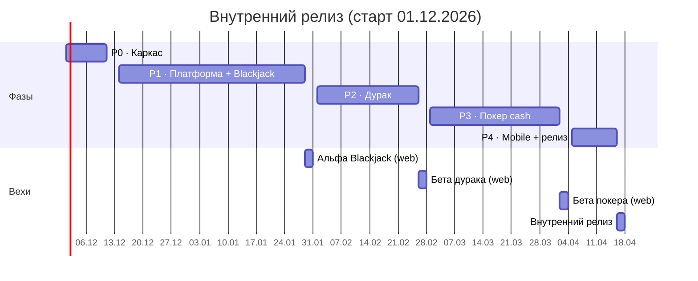

# План (внутренний проект)

| | |
|---|---|
| **Статус** | Draft v2.0 — упрощённая версия |
| **Дата** | 25.11.2026 |
| **Старт** | 01.12.2026 |
| **Внутренний релиз** | 16.04.2027 (~20 недель) |
| **Связанные документы** | [Обзор](./00-overview.md) · [Архитектура](./01-architecture.md) · [Стек](./02-stack.md) · [Игровые движки](./03-game-engines.md) |

---

## 1. Подход

- **Одна команда, один контейнер, три игры последовательно.** Blackjack → дурак → покер. Каждая следующая игра переиспользует платформу; риск растёт по сложности.
- **Вертикальные слайсы.** Каждая фаза заканчивается играбельным результатом в браузере, а не набором слоёв.
- **Без публичного запуска.** Нет сторов, маркетинга, монетизации, SLO и дежурств. Есть внутренний URL и договорённость «если упало — перезапустим».
- **Простое качество.** Тесты правил — обязательны (это ядро), нагрузочные тесты и пентесты — нет.
- **Один буфер.** Неделя перед релизом не планируется под фичи — только фиксы.

---

## 2. Скоуп

### 2.1 Входит

| Блок | Содержание |
|---|---|
| Аккаунты | регистрация по инвайту, вход, профиль, роли |
| Локализация | русский и английский, переключатель, выбор в профиле |
| Кошелёк | баланс фишек, история операций, начисление админом |
| Лобби | до 5 столов, набор настраивает админ |
| Blackjack | соло-стол, 6 колод, S17, DAS, сплит, double, страховка, сдача |
| Дурак | 2–6 игроков, подкидной (по умолчанию) и переводной, таймеры, рейтинг |
| Покер | NLHE cash 6-max, блайнды, сайд-поты, вскрытие, история рук |
| Чат | за столом, простая модерация (удаление сообщения админом) |
| История | список раздач, просмотр и реплей |
| Админка | пользователи, инвайты, фишки, столы, раздачи, конфиги |
| Mobile | iOS/Android (Expo), внутренние сборки |

### 2.2 Не входит

Турниры (SNG/MTT), магазин и косметика, IAP и любые платежи, сезоны и battle pass, друзья/кланы, пуши, спектатор-режим турниров, антиколлюзия, ML-детекторы, публичный верификатор честности, публикация в сторах, HA и мультирегион.

Если что-то из этого понадобится — это отдельная задача с отдельной оценкой (см. §8).

---

## 3. Дорожная карта

| Фаза | Период | Длит. | Цель | Результат |
|---|---|---|---|---|
| **P0. Каркас** | 01.12–11.12.2026 | 2 нед | Фундамент | Структура проектов, CI, Docker Compose, схема БД, auth, Mantine+RTK скелет, WS-спайк |
| **P1. Платформа + Blackjack** | 14.12.2026–29.01.2027 | 7 нед | Играбельный blackjack end-to-end | Runtime, протокол, кошелёк, лобби, стол, история, админка v0, альфа |
| **P2. Дурак** | 01.02–26.02.2027 | 4 нед | Мультиплеер | Дурак (2 варианта), таймеры, чат, рейтинг Elo, бета |
| **P3. Покер cash** | 01.03–02.04.2027 | 5 нед | Самая сложная игра | NLHE 6-max: торги, сайд-поты, вскрытие, история, бета |
| **P4. Mobile + релиз** | 05.04–16.04.2027 | 2 нед | Мобильный клиент и стабилизация | Внутренние сборки, полировка, релиз |

Итого: **20 недель**, из них неделя (12–16.04) — буфер на фиксы и сборки.

### 3.1 Вехи и критерии

| Веха | Дата | Критерий |
|---|---|---|
| Альфа Blackjack | 29.01.2027 | команда играет полные раунды в web; история раздач; 0 P0 |
| Бета дурака | 26.02.2027 | игра 2–6 человек с таймерами и рейтингом; чат; реконнект |
| Бета покера | 02.04.2027 | 6-max cash, сайд-поты проверены на эталонных раздачах |
| Внутренний релиз | 16.04.2027 | web + APK/TestFlight; админка; инструкция |

---

## 4. Команда

| Роль | FTE | Зона ответственности |
|---|---|---|
| Tech Lead / backend | 1.0 | архитектура, runtime, протокол, инфраструктура, ревью |
| Backend / game | 1.0 | движки игр, правила, тесты, кошелёк, админка-API |
| Web / fullstack | 1.0 | Mantine-интерфейс, Redux Toolkit, экраны, лобби, админка |
| Mobile | 0.5–1.0 | Expo-приложение, сборки, экраны игр (с фазы P2) |
| Дизайн / QA | 0.5 | макеты, тест-чек-листы, приёмка, ручное тестирование |

Пиковая численность — 4–4.5 человека в фазе P2–P3.

**Варианты:**

| Вариант | Состав | Срок |
|---|---|---|
| Минимальный | 2 разработчика (fullstack) + 0.5 дизайн/QA | ~9–10 месяцев |
| Рекомендуемый | 3.5–4 FTE (таблица выше) | 20 недель |
| Быстрый | 5–6 FTE | ~13–15 недель |

---

## 5. Оценки

### 5.1 По эпикам (человеко-дни, включая тесты и ревью)

| # | Эпик | pd |
|---|---|---|
| E0 | Каркас: структура проектов, CI, Docker Compose, схема БД | 12 |
| E1 | Auth, профили, инвайты, роли, админка-API | 15 |
| E2 | Кошелёк: баланс, транзакции, начисление, идемпотентность | 10 |
| E3 | Runtime + протокол: актор, seq, проекции, реконнект, таймеры | 22 |
| E4 | Blackjack: движок, UI, история, seed | 25 |
| E5 | Дурак: движок, 2 варианта, UI, таймеры | 30 |
| E6 | Покер: движок, торги, сайд-поты, оценка рук, UI | 50 |
| E7 | Web: лобби, профиль, история, админка, Mantine-компоненты | 36 |
| E8 | Mobile: каркас, лобби, три игры, сборки | 30 |
| E9 | QA: property/golden-тесты, Playwright, приёмка | 18 |
| E10 | Дизайн: макеты, карты, состояния | 10 |
| E11 | i18n: ресурсы RU/EN, переключатель, форматирование | 6 |
| | **Итого** | **264** |

### 5.2 Проверка на реальность

| Вариант | Ёмкость | Вывод |
|---|---|---|
| 3.6 FTE × 20 нед × 5 дн × 0.8 | ≈ 288 pd | 264 pd + ~9% буфера + неделя в конце — **реально** |
| 2 FTE | ≈ 160 pd | не хватает → 9–10 месяцев или web-only без mobile |
| 5.5 FTE | ≈ 440 pd | ~13–15 недель |

Главный риск переоценки — покер: 50 pd на движок + UI выглядят достижимо только при готовых правилах, тестах и отсутствии турниров.

---

## 6. Бюджет

| Статья | Оценка |
|---|---|
| Разработка (3.6 FTE × ~4.6 мес ≈ 16.5 чел-мес × $4–6k) | **$66–99k** |
| Инфраструктура (MVP — существующая машина; позже ~$10–15/мес) | ~$0–25 |
| Домен, мелочи | ~$50 |
| **Итого (если аутсорс)** | **~$66–99k** |

Если команда внутренняя — это стоимость зарплат на ~4.6 месяца, отдельных затрат нет.

---

## 7. Спринты

Спринты по 2 недели; в скобках — ключевой результат.

| Спринт | Даты | Содержание |
|---|---|---|
| S1 | 01.12–11.12 | Структура проектов, CI, Docker Compose, схема БД, auth, Mantine+RTK каркас, WS-спайк |
| S2 | 14.12–25.12 | Runtime + протокол, движок blackjack (база), кошелёк, лобби, стол blackjack, каркас i18n |
| S3 | 04.01–15.01 | Blackjack полностью (сплит, double, страховка, сдача), история, реконнект, админка v0 |
| S4 | 18.01–29.01 | Фиксы, полировка, тесты правил, альфа для команды (P1 gate) |
| S5 | 01.02–12.02 | Дурак: движок, раздача, атака/защита, добор, стол |
| S6 | 15.02–26.02 | Дурак: переводной, 3–6 игроков, таймеры, чат, рейтинг Elo, бета |
| S7 | 01.03–12.03 | Покер: движок, торги, сайд-поты, оценка рук, тесты |
| S8 | 15.03–26.03 | Покер: UI стола, вскрытие, история, реконнект, бета |
| S9 | 29.03–09.04 | Покер: фиксы, mobile-клиент, i18n RU/EN, полировка, сборки |
| — | 12.04–16.04 | Буфер: стабилизация, инструкция, внутренний релиз |

### 7.1 Спринт 1 подробно (пример детализации)

| Задача | d | Ответственный |
|---|---|---|
| Kickoff: скоуп, роли, процесс, договорённости по правилам | 1 | TL + PM |
| Проекты: pnpm, Biome, Vitest, tsconfig | 2 | TL |
| Docker Compose (app, postgres), `.env.example` | 2 | TL |
| CI: lint/test/build; запуск контейнера локально | 2 | TL |
| Схема БД v0 + миграции Drizzle | 2 | Backend |
| Auth: инвайты, регистрация, логин, JWT-cookie, ws-тикет | 3 | Backend |
| NestJS + Fastify каркас, `/health`, обработка ошибок | 2 | Backend |
| Web: Vite + React, Mantine, RTK store, React Router, лобби-заглушка | 3 | Web |
| Дизайн: макет лобби и стола blackjack, карты | 3 | Design |
| Спайк: WS join → snapshot → action → broadcast → resume | 2 | TL |

**Демо S1:** задеплоенный URL, вход по инвайту, лобби-заглушка, WS-снапшот.

---

## 8. Риски

| # | Риск | P | Влияние | Митигация |
|---|---|---|---|---|
| 1 | Покер сложнее, чем кажется | Выс | Сдвиг на 1–2 нед | Спека правил до кода, property/golden-тесты, эталонные раздачи, буфер |
| 2 | Scope creep: коллеги просят турниры/магазин/фичи | Выс | Сдвиг | Список «не входит» согласован; новые фичи — отдельная оценка |
| 3 | Утечка скрытых карт из-за ошибки в проекции | Сред | Подрыв доверия | Автотест «нет чужих карт» на 10k раздач, ревью проекций |
| 4 | Нет выделенного QA | Сред | Баги в релизе | Тесты правил + Playwright + чек-лист приёмки |
| 5 | Мобильные сборки затягивают | Сред | Сдвиг | Web-first; mobile — PWA как fallback; сборки начать с S8 |
| 6 | Простой единственного контейнера | Низ | 1–5 мин недоступности | `restart: unless-stopped`, быстрый перезапуск |
| 7 | Споры о правилах дурака/покера | Сред | Переделки | Вариант по умолчанию зафиксирован в спеке, всё спорное — в конфиг |
| 8 | Январские праздники | Выс | −1–2 нед ёмкости | Учтено в плане (S3 короче, буфер в конце) |
| 9 | EN-переводы не готовы к релизу | Сред | Низкое | Строки только в ресурсах, перевод параллельно, финальная вычитка в S9 |
| 10 | Потеря БД/истории | Низ | Низкое | Бэкапов нет осознанно; при необходимости включается `pg_dump` за 10 минут |

---

## 9. Definition of Done

Фича считается готовой, если:

- [ ] Работает в web и (для игровых экранов) в mobile.
- [ ] Правила покрыты тестами: unit + property + хотя бы один golden-replay.
- [ ] Нет открытых P0-багов; P1 — не больше двух на релиз.
- [ ] Ошибки обрабатываются и логируются, пользователь видит понятное сообщение.
- [ ] Админ может найти и разобрать раздачу (история + реплей).
- [ ] Нет хардкода карт/секретов на клиенте; чужие карты не уходят.
- [ ] Все строки в ресурсах; переключение RU/EN работает на web и mobile.
- [ ] Обновлены README/инструкция, если появились новые операции.

---

## 10. Метрики

Продуктовых метрик и монетизации нет. Смотрим только на полезность и здоровье:

| Метрика | Как считаем |
|---|---|
| WAU | уникальные игроки за неделю (из 100 аккаунтов) |
| Игр в день | число завершённых раздач/партий |
| Средняя сессия | время от входа до выхода |
| Ошибки | число 5xx и ошибок действий за сутки |
| Доступность | минуты недоступности в рабочее время |
| Отзывы | внутренний чат/опрос раз в месяц |

---

## 11. Релиз и эксплуатация

- **Web:** контейнер на машине во внутренней сети, `http://<host>:8080`; домен и HTTPS — когда решим хостинг.
- **Mobile:** Android APK раздаётся ссылкой, iOS — TestFlight для внутренних тестировщиков. Сторы не используем.
- **Аккаунты:** админ создаёт инвайты, сотрудники регистрируются сами.
- **Поддержка:** внутренний чат + админка; инциденты чинятся в рабочее время.
- **Обновления:** деплой по кнопке в GitHub Actions, вечером или по договорённости; откат — предыдущий коммит.
- **Инструкция:** короткий README для игроков (как зайти, правила, что делать при сбое) и runbook для админа (перезапуск, типовые ошибки).

---

## 12. Первая неделя

| День | Действие | Результат |
|---|---|---|
| 1 | Kickoff, фиксация скоупа и вариантов правил, роли | согласованный план на 2 недели |
| 1–2 | Проекты, pnpm, Biome, Vitest | `pnpm build` и `pnpm test` проходят в каждом проекте |
| 2 | Docker Compose, `.env.example` | локальный стек поднимается одной командой |
| 3 | Схема БД v0 + миграции, auth-скелет | миграции применяются |
| 3 | CI + Docker Compose | стек поднимается, `/health` отвечает |
| 4 | Vite + React + Mantine + RTK каркас | лобби-заглушка в браузере |
| 4 | Дизайн-макет лобби и стола | макеты в Figma/фигме-аналоге |
| 5 | WS-спайк: join/snapshot/action/resume | демо на staging |

---

## 13. Решения, которые нужны до старта

| # | Вопрос | Ответ | Влияние |
|---|---|---|---|
| 1 | Аудитория | до 5 столов, ~30 игроков — **решено** | без масштабирования |
| 2 | Мобильное приложение | **нужно** | входит в план, ~30 pd |
| 3 | Турниры | **нет** | не входят |
| 4 | Хостинг | MVP — Docker-контейнер; позже решим | HTTPS/домен позже |
| 5 | Дедлайн | 16.04.2027 | влияет на состав команды |
| 6 | SSO | нет, email+пароль | 0 дней |
| 7 | Языки | RU + EN — **решено** | +6 pd |
| 8 | Бэкапы БД | нет — **решено** | 0 |
